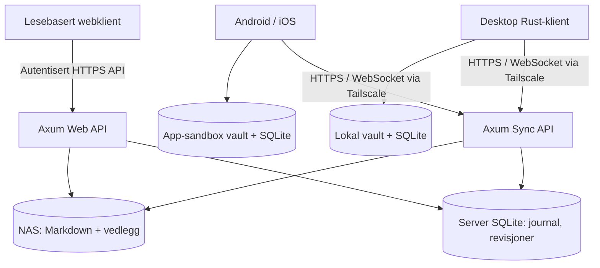

# SyvendeSans – prosjektskisse

**Dato:** 12. november 2026  
**Status:** Teknisk forprosjekt. Rammeverk og gjenbrukskandidater er ikke endelig bestemt.  
**Produkt:** Rask, lokal-først og selvhostet Markdown-notatapp som kan lese eksisterende Obsidian-vaults på Windows, Linux, macOS, Android, iOS og i nettleser.

> Dette dokumentet samler opprinnelig prosjektskisse. Se også [vurdering av eksisterende prosjekter](RUST_EDITOR_RESEARCH.md), der fork-vs-bibliotek analyseres nærmere.

## 1. Sammendrag

Bygg en **plattformuavhengig Rust-kjerne** for vault, Markdown-semantikk, fulltekstssøk og dokumentbasert synkronisering. Bruk vanlige `.md`-filer og vedlegg som sannhetskilde; SQLite brukes kun til avledede indekser og revisjons-/synkmetadata. Desktop/mobil skal kunne arbeide helt offline. Serveren kjører selvhostet på NAS med Axum og valgfri Tailscale/Headscale-tilgang. Webklienten skal primært være en autentisert **read-only renderer**, uten lokal synkmotor.

UI-sporet må avklares ved en plattformtest. **Dioxus 0.7** er første kandidat for Rust på desktop, mobil og web; **Tauri 2 + CodeMirror 6** er et pragmatisk alternativ. **egui/eframe** og gjenbruk av eksisterende Rust-editorer skal vurderes eksplisitt. Ikke lås UI før faktisk Android/iOS-tasting, IME, seleksjon og ytelse er testet.

## 2. Produktmål

**MVP:**

- Vanlige vault-mapper og Markdown-filer som kan åpnes uten migrering i Obsidian/VS Code.
- Offline lesing, redigering, autosave og gjenoppretting på desktop og mobil.
- Mappevisning, hurtigåpning, faner, søk, tags, frontmatter og backlinks.
- GFM-tabeller, oppgavelister, koder, fotnoter, `[[wikilenker]]`, `[[mål|alias]]`, `![[embeds]]` og callouts.
- Historikk, konflikthåndtering, sletting/rename og robust toveis synk til NAS.
- Vedlegg og bilder som ordinære filer.
- En privat read-only webklient med søk og fungerende interne lenker.
- Eksport, import og separate sikkerhetskopier.

**Senere:** samarbeid i sanntid/CRDT, Canvas, grafvisualisering, plugin-API, E2EE, full WYSIWYG, PDF-annotering og egen WireGuard-klient. Obsidian-plugin-API er ikke kompatibilitetsmål i MVP.

## 3. Arkitektur



Foreslått Rust-workspace:

```text
SyvendeSans/
  Cargo.toml
  crates/
    core/             # Identiteter, notatmodell, feiltyper
    markdown/         # Parseradapter, wikilenker, sanitizer
    vault/            # Atomisk fil-I/O, rescan, journal
    index/            # SQLite FTS5, tags, backlinks
    sync-protocol/    # Versjonerte meldinger og format
    sync-client/      # Kø, retries, konflikter, lokal cursor
    sync-server/      # Axum, revisjoner, blob og commits
    platform/         # Keychain/Keystore, OS-filtilgang
  apps/
    desktop-mobile/   # Valgt UI-rammeverk
    web/              # Read-only klient
    server/           # NAS-runtime
  tests/
    fixtures/
    interoperability/
    sync-chaos/
  docs/
    adr/
    benchmarks/
  deploy/docker/
```

*Avhengighetsregel:* `core`, `markdown` og `sync-protocol` skal ikke avhenge av UI. Web bygger ikke inn sync-klient eller OS-Tailscale. SQLite og filsystem ligger i native plattformadaptere og server.

## 4. UI og editor

| Kandidat | Desktop | Mobil | Web | Kommentar |
|---|---|---|---|---|
| Dioxus 0.7 | Ja | Android og iOS | WASM/DOM | Mye felles Rust, WebView på native |
| Tauri 2 | Ja | Android og iOS | Frontend serveres separat | Gode OS-integrasjoner, vanligvis TS/JS UI |
| egui/eframe | Ja | Android; iOS må valideres | WASM | Rent Rust/GUI; editor/IME må evalueres |
| Slint | Ja | Ja | WASM/canvas | Mindre naturlig for webdokumenter |
| GPUI | Ja | Ikke komplett løsning | Nei | Lovende native desktop, men ikke mobil/web |

Kjør tekniske spikes med *samme dokument* og arbeidsflyt for Dioxus/CodeMirror og eventuelt egui. Mål oppstart, RAM, editorresponstid, tekstseleksjon, IME, Unicode/emoji, markering og scrolling for 1 KB–1 MB notater. Bruk fysisk Android og iOS; et vellykket kompilasjonssteg er ikke nok.

Bruk **CodeMirror 6** hvis raske og robuste mobilredigeringsfunksjoner er viktigere enn at også editor-widgeten er skrevet i Rust. Hold denne i en isolert adapter slik at rendering/synk/data fortsatt er Rust. Rust-alternativ: `ropey` + egen native widget eller gjenbruk av et fritt prosjekt etter lisens- og mobilvurdering.

## 5. Markdown

Primært bibliotek: **pulldown-cmark**. Benchmark mot **comrak** på et representativt, versjonert Obsidian-testvault før avgjørelsen låses. Parsing alene må ikke forveksles med faktisk renderingstid; DOM/GPU-oppdatering og layout kan dominere.

Pipeline:

1. Les fil, bruk BLAKE3-hash for caching.
2. Parse i Rust til hendelser eller AST.
3. Tolke wikilenker, alias, embeds, tags, callouts og frontmatter mot vault-indeks.
4. Avvis/sanitér rå HTML, farlige skjemaer og eksterne ressurser.
5. Render sikkert til DOM eller native GUI-widget.
6. Last tunge bilder, kodeblokker, Mermaid og matematikk etter behov.
7. Mål parsing, transformasjon, tekstlayout og end-to-end latens separat.

Konsistenskrav: rendret visning og lenkeindeks må dele samme semantikk. Ikke stol på `dangerous_inner_html` uten sanitization og streng CSP.

## 6. Lagring

- **Sannhetskilde:** originalt Markdown/vedlegg på disk, ikke proprietær database.
- **Metadataindeks:** SQLite FTS5, heading/target-ID, tags, frontmatter, backlinks. Kan bygges opp igjen fra filene.
- **Identitet:** stabil `file_id` uavhengig av sti, `device_id`, innholdshash, parent-revisjon, serverrevisjon, deletion tombstone og synkcursor.
- **Sikker skriving:** tempfil + flush/fsync når mulig + atomisk rename; journal/reconciliation håndterer tilfeller hvor filsystem og SQLite ikke kan oppdateres atomisk sammen.
- **Eksterne endringer:** `notify` + full rescan ved oppstart/etter frakobling; håndter fil-rename, case-folding, symbolske lenker og samtidige endringer fra Obsidian.
- **Formatbevaring:** ikke omskriv frontmatter, linjeskift, filencoding eller ukjente felt når bare et avsnitt endres.

Foreslått synkobjekt (ikke etablert wire-format):

```json
{
  "file_id": "01926f11-6b2b-7c18-8b1a-e10b91ad6233",
  "path": "Prosjekter/Ideer.md",
  "kind": "markdown",
  "content_hash": "blake3:<hex>",
  "revision": 18,
  "base_revision": 16,
  "deleted": false
}
```

## 7. Synkroniseringsprotokoll v1

**Dokumentbasert, revisjonert, offline-first via HTTPS.** Sanntids-CRDT er ikke en forutsetning.

1. Endringer lagres lokalt først og legges i en varig kø.
2. Klienten henter serverens endringer fra `GET /v1/changes?since=cursor`.
3. Manglende blobs hentes/sendes etter innholdshash.
4. Klienten sender `POST /v1/commits` med `file_id`, forventet baserevisjon og innhold.
5. Serveren validerer token, vault-ACL, baserevisjon/CAS, størrelse og hash.
6. Suksess oppretter monotont server-cursor og synknotifikasjon via WebSocket.
7. Hvis samme notat er endret to steder: konservativ treveis merge; ellers konfliktkopi. Ingen stille last-write-wins.
8. Synkcursor oppdateres **etter** at endringene er varig materialisert på klienten.
9. Tombstones og historikk beholdes for sent tilkoblede klienter og gjenoppretting.

Test: nettbrudd før/etter commit, duplikater, idempotency keys, store vedlegg, rename/delete-konflikter, ekstern editor, klient- og serverkrasj, repetert gjenoppretting og feil på disk.

Hvis sanntidssamarbeid blir nødvendig, vurder **Loro**, **Automerge** og **Yrs**, men behold API og lokal Markdown som interoperabilitetskrav.

## 8. Tailscale, Headscale, WireGuard

MVP har **ingen innebygd VPN**. Bruk operativsystemets Tailscale-klient på desktop/mobil. NAS er node i samme tailnet; Rust-klient åpner vanlig TLS/HTTP og WebSocket til et privat MagicDNS-navn. Browseren nås gjennom Tailscale Serve eller annen privat HTTPS-terminering.

**Headscale** kan senere erstatte Tailscales kontrollplan for fullere selvhosting. Dette krever egen operasjonell vurdering, også for DERP/relé.

Unngå `tailscale-rs` i produksjon til sikkerhetsstatus er endret; `tsnet` er Go, ikke ren Rust. BoringTun/WireGuardKit og Android-tunnel-API kan vurderes hvis egen VPN faktisk blir et senere produktkrav. Tailscale/WireGuard beskytter transporten; siden serveren leser filene, er det *ikke* E2EE / zero-knowledge lagring.

## 9. Server, autentisering og drift

- Axum-server i Docker/OCI på NAS. Persistente mounts for vault, SQLite, historikk og backup.
- Separate device-tokens og tilgangskontroll per vault. Ikke stol på kilde-IP eller Tailscale alene.
- Tokens og nøkler i Keychain/Keystore; mulighet for tilbakekalling.
- Read-only web-API må håndheves på server, ikke bare ved skjulte knapper.
- Normaliser og kontroller paths; avvis traversal og farlige symlinks.
- CSP, HTML-sanitizer, grenser for upload, begrensede URL-skjemaer og ingen ekstern innebygd script-kjøring fra notater.
- Ikke eksponer privat web/API via Tailscale Funnel som standard.
- Helseendepunkt, sporbare sync-hendelser uten notatinnhold i logger, backup/restore og verifiserbar revisjonshistorikk.
- **Synk er ikke backup.** Ha versjonerte sikkerhetskopier med reell restore-test.

## 10. Milepæler og exit-kriterier

| Fase | Leveranse | Godkjenningskriterium |
|---|---|---|
| 0 | Dioxus/Tauri/egui-spike | Mobil tastatur, filer, IME, tekstmarkering og ytelse bekreftet |
| 1 | Offline desktop + lesemodus | Kan åpne eksisterende vault uten konvertering eller datatap |
| 2 | Rust-server og synk v1 | To klienter, offline, konflikter, rename/delete og recovery |
| 3 | Android + iOS | Native sandbox, import/eksport, foregrunnssynk |
| 4 | Privat read-only web | Søkbart vault bak Tailscale Serve |
| 5 | Herde/utgivelse | Chaos-test, HTML-sikkerhet, backup restore, CI |
| 6 | Valgfrie utvidelser | CRDT, Canvas, plugin-API, Headscale/WireGuard |

**Ytelsesbudsjetter (mål, ikke målte fakta):** p95-notatåpning <150 ms varm cache; vanlig Markdown-visning <50 ms; FTS-søk i 10 000 notater <100 ms; stabil 60 fps under scroll; UI aldri blokkert av sync. Benchmark på desktop og fysisk Android/iOS med 1 000/10 000/50 000 notater, store tabeller, syntaks, bilder og vedlegg.

## 11. Hovedrisiko

| Risiko | Tiltak |
|---|---|
| Dioxus/mobil redigering er ikke god nok | Fysisk mobilspike og Tauri + CodeMirror reserve |
| Synkronisering kan slette data | CAS, revisjoner, konfliktkopier og chaos-tester |
| Markdown kan kjøre farlig HTML | Sanitering, CSP og streng URL-validering |
| iOS gir begrenset bakgrunnskjøring | Foreground-first og tydelig syncstatus |
| Andre editorer endrer filene | Hash + full rescan og byte-bevarende endringer |
| VPN feiltolkes som E2EE | Dokumenter trust boundary |
| Fork gjør prosjektet desktop-låst | Undersøk biblioteker og skill UI fra kjernen |

## 12. Første issues

1. ADR: Markdown-vault som sannhetskilde; format- og bytebevaring.
2. Spike: Desktop/Android/iOS/web UI med reell editor.
3. Benchmark: pulldown-cmark, comrak og eventuell spesialisert parser.
4. Core: dokument-ID, wikilink resolution, frontmatter og backlinks.
5. Vault: atomiske writes, journal, watcher og rescan.
6. Sync v1: API, versjoner, blobs, tombstones og konflikt-policy.
7. Axum-server med autentisering og NAS-deploy.
8. Synk-chaos-tests og gjenopprettingsprotokoll.
9. Mobil lagring, secure store og foreground sync.
10. Read-only web, CSP og HTML-sikkerhet.
11. Docker, Tailscale Serve og backup/restore.
12. Målbar ytelsesregresjon i CI.

## 13. Primærkilder

- [Dioxus plattformer](https://dioxuslabs.com/learn/0.7/guides/platforms/)
- [Dioxus mobile](https://dioxuslabs.com/learn/0.7/guides/platforms/mobile/)
- [Tauri 2](https://v2.tauri.app/)
- [pulldown-cmark](https://docs.rs/pulldown-cmark/)
- [Comrak](https://comrak.ee/)
- [Obsidian data storage](https://obsidian.md/help/data-storage)
- [Tailscale Serve](https://tailscale.com/docs/features/tailscale-serve)
- [Headscale](https://headscale.net/)
- [tailscale-rs](https://github.com/tailscale/tailscale-rs)
- [Axum](https://docs.rs/axum/)
- [Loro](https://loro.dev/)
- [BoringTun](https://github.com/cloudflare/boringtun)
- [WireGuard embedding](https://www.wireguard.com/embedding/)

**Foreløpig beslutning:** behold Rust-kjernen og lokal-først/synk/server-arkitekturen som beskrevet. Valg av editor, parser og om vi skal forke et eksisterende prosjekt avgjøres gjennom [gjenbruksvurderingen](RUST_EDITOR_RESEARCH.md) og tekniske spikes.
